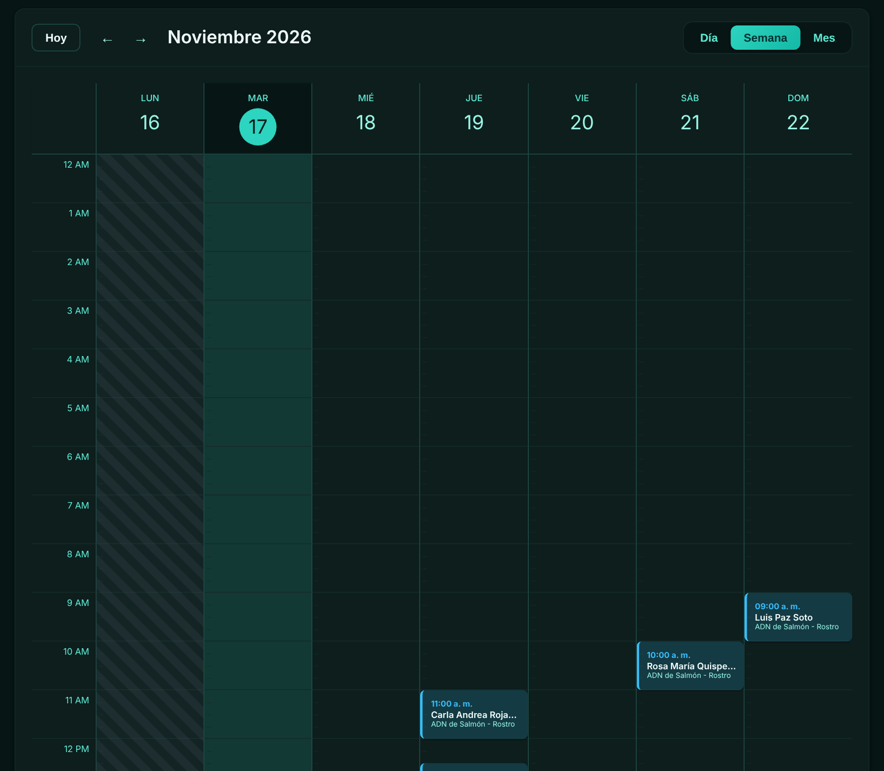
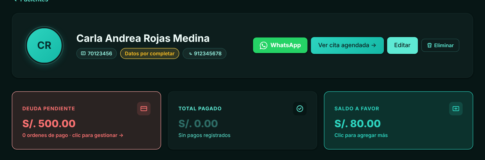
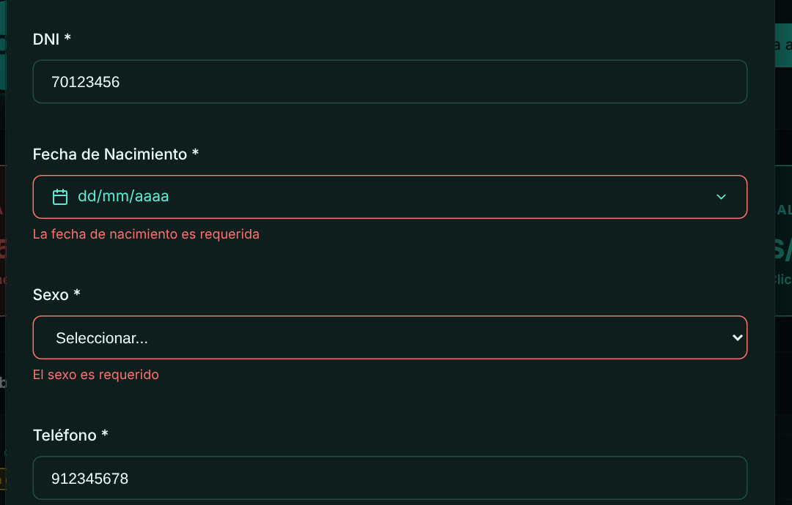
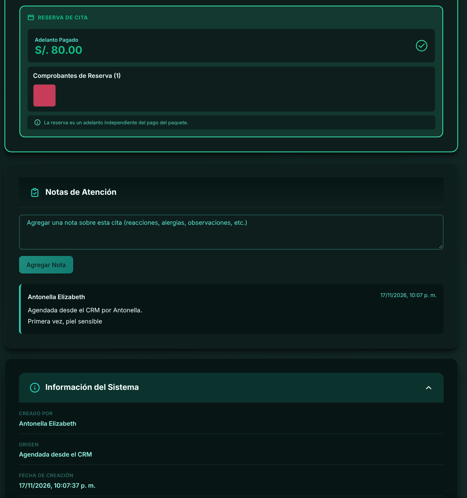

# Citas que llegan del CRM: cómo se ve en el ERP

Capturas de un entorno local con datos de prueba, enviados por
`POST /api/integrations/crm/appointments`.

## Las citas del CRM en el calendario

Aparecen como cualquier otra cita, a la hora de Lima.

## Ficha de un paciente creado desde el CRM

"Datos por completar" en lugar de una edad y un sexo inventados, y el adelanto
ya como saldo a favor.

## Al editarlo hay que completar sus datos

La fecha de nacimiento y el sexo llegan vacíos y son obligatorios.

## Detalle de la cita

El adelanto con su comprobante, la nota con lo que escribió ventas y el origen.

